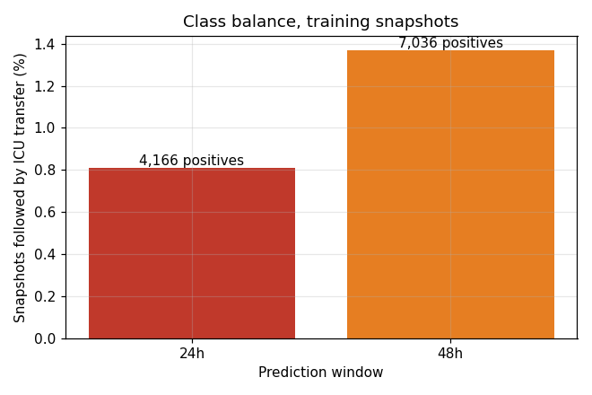
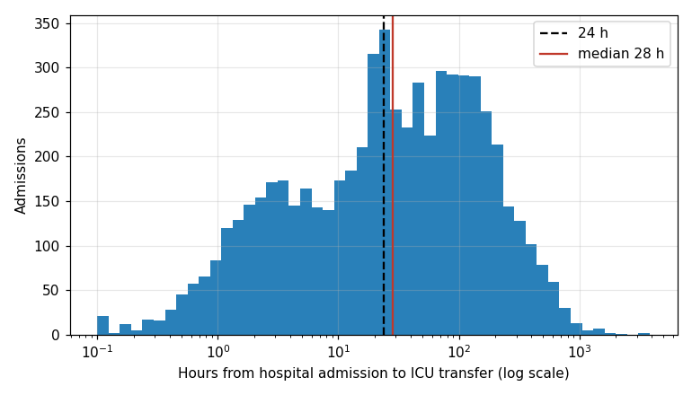
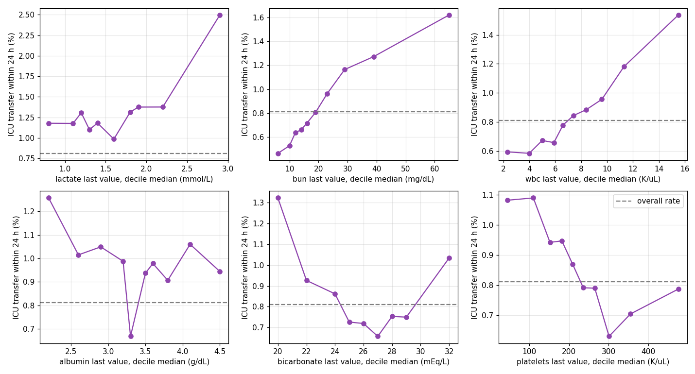
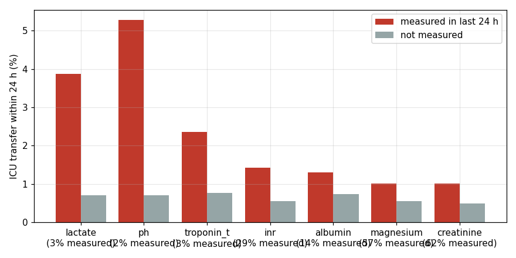
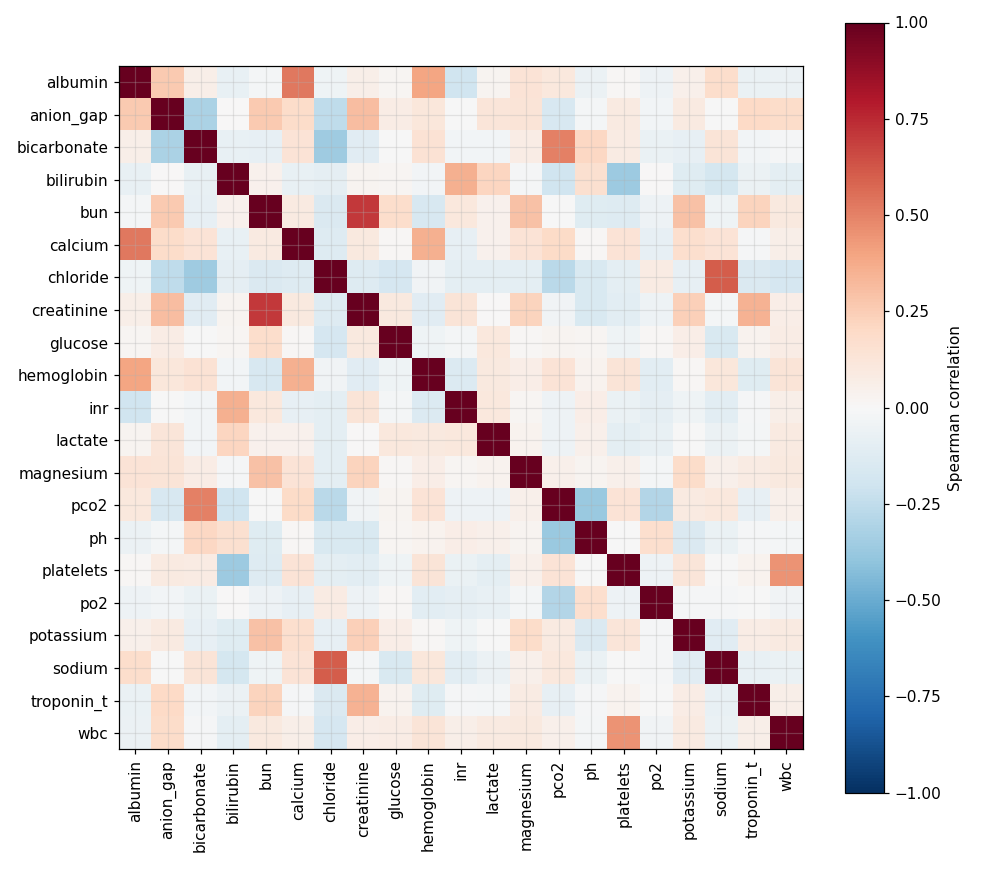
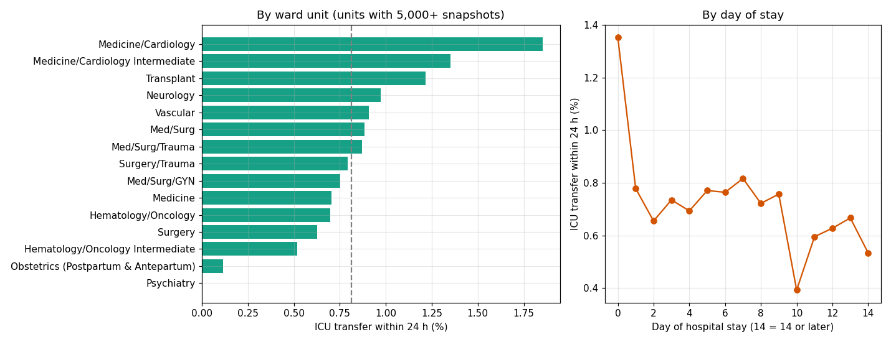
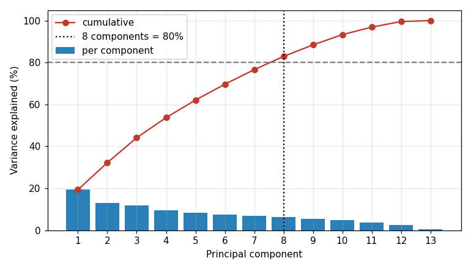
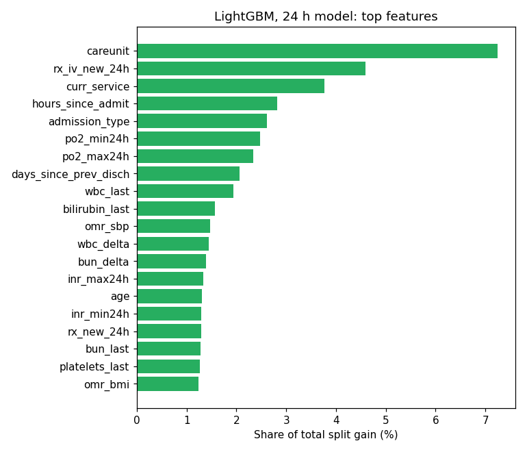

# Data Pipeline: Configuration, Cleaning, Split, Features, Preparation

## 1. Configuration (`config.yaml`)

All decisions live in one file, so the code contains no hard-coded paths or numbers.

| Setting | Value | Reason |
|---|---|---|
| `seed` | 42 | reproducible split and models |
| `split` | 0.6 / 0.2 / 0.2 | from M2 |
| `readmit_window_days` | 365 | M2 definition of "frequently admitted" |
| `planned_admission_types` | ELECTIVE, SURGICAL SAME DAY ADMISSION | both are scheduled; their ICU stays are planned, not deterioration |
| `icu_units` | 8 true ICUs (MICU, SICU, MICU/SICU, CCU, CVICU, TSICU, Neuro SICU, ICU) | step-down units (Neuro Intermediate, Neuro Stepdown) are not ICUs |
| `non_ward_units` | Emergency Department, ED Observation, Discharge Lounge, UNKNOWN | the patient is not on an inpatient ward there |
| `snapshot.hour` | 8 | one prediction per morning, matching bed-planning rounds |
| `labs` | item ID plus plausible minimum and maximum | values outside the range are recording errors |
| `drug_classes` | name patterns per class | groups thousands of drug names into 6 classes |
| `comorbidities` | ICD-9 and ICD-10 prefixes | groups diagnosis codes into 7 conditions |

---

## 2. Cleaning (`clean.py`): before and after

### 2.1 Admissions

| Step | Before | Removed or changed | After |
|---|---|---|---|
| Raw admissions | 546,028 | | 546,028 |
| Duplicate `hadm_id` | 546,028 | 0 | 546,028 |
| Discharge time not after admission time (impossible) | 546,028 | 180 removed | 545,848 |
| Death time before admission time | | 11 set to missing | 545,848 |
| Admission overlapping the previous stay | | 47 flagged (not counted as readmissions) | 545,848 |

### 2.2 Transfers

| Step | Before | Removed | After |
|---|---|---|---|
| Raw transfers | 2,413,581 | | 2,413,581 |
| No `hadm_id` (emergency visits without admission) | 2,413,581 | 408,977 | 2,004,604 |
| "discharge" events (not a location) | 2,004,604 | 546,024 | 1,458,580 |
| Out time before in time | | 0 | 1,458,580 |
| Exact duplicates | | 3 | 1,458,577 |
| Kept for cohort admissions | | | 445,289 |

Check: the first ICU entry from `transfers` matches `icustays` within 1 minute for **97.2%** of admissions.

### 2.3 Cohort construction

| Step | Rule | Admissions after | Removed |
|---|---|---|---|
| 0 | all valid admissions | 545,848 | |
| 1 | previous discharge within 365 days | 236,742 | 309,106 |
| 2 | not planned (ELECTIVE, SURGICAL SAME DAY) | 214,845 | 21,897 |
| 3 | adult (18+) | 214,845 | 0 |
| 4 | has at least one ward stay | 183,190 | 31,655 |
| 5 | not admitted straight to the ICU | **168,908** | 14,282 |

**Final cohort:** 168,908 admissions, 63,595 patients, 10,377 (6.1%) with an unplanned ward-to-ICU transfer.

Why the frequent-admission rule is applied per admission (has a previous admission within 365 days)
and not per patient: a per-patient rule would use **future** admissions to decide who is in the cohort,
which the model cannot know at prediction time.

### 2.4 Labs (`labevents`, 2.6 GB)

Streamed in 64 MB blocks with pyarrow, keeping only cohort admissions and the 21 selected tests.

| Step | Before | Removed or changed | After |
|---|---|---|---|
| Raw rows read | 158,374,764 | | |
| Cohort admissions and 21 tests | 158,374,764 | 145,594,359 not needed | 12,780,405 |
| No numeric value (e.g. "hemolyzed", "see comment") | 12,780,405 | 56,089 | 12,724,316 |
| Release time before draw time | | 39 fixed (set to draw time) | |
| Implausible values (outside config range) | 12,724,316 | 342 | 12,723,974 |
| Duplicate results | 12,723,974 | 1,321 | **12,722,653** |

Implausible values by test: glucose 95, magnesium 69, creatinine 59, calcium 49, pO2 16, sodium 13,
potassium 9, others 32. These are recording or unit errors (e.g. a pH of 70), not genuine extremes,
so they are removed. Genuine extremes inside the range are kept: a lactate of 15 mmol/L is rare but real
and is exactly the signal the model needs.

### 2.5 Prescriptions

| Step | Before | Removed | After |
|---|---|---|---|
| Raw rows read | 20,292,611 | | |
| Cohort admissions | 20,292,611 | 13,371,951 | 6,920,660 |
| Missing start time or drug name | 6,920,660 | 9,754 | 6,910,906 |
| Duplicate orders | 6,910,906 | 637,782 | **6,273,124** |

Drug names were lower-cased and grouped into classes: anticoagulant 344,985 orders, opioid 318,794,
antibiotic 283,517, insulin 266,277, diuretic 192,395, vasopressor 15,571.

### 2.6 Outpatient measurements (`omr`)

| Step | Before | Removed | After |
|---|---|---|---|
| Rows for cohort patients | 4,015,624 | | |
| Blood pressure "120/80" split into systolic and diastolic | 4,015,624 | | more rows (one per measure) |
| Unparsable values | | 0 | |
| Implausible (diastolic 1,148, BMI 642, weight 615, systolic 10) | | 2,415 | |
| Same patient, day and measure averaged | | | **4,729,798** |

### 2.7 Diagnoses and services

| Table | Before | Removed | After |
|---|---|---|---|
| Diagnoses (cohort patients) | | 301 duplicate codes | 4,304,433 |
| Services (cohort admissions) | | 0 duplicates | 184,113 |

### 2.8 Output files (`data/processed/`)

| File | Rows | Columns |
|---|---|---|
| `cohort.parquet` | 168,908 | 12 |
| `admissions_all.parquet` | 545,848 | 5 |
| `transfers.parquet` | 445,289 | 6 |
| `labs.parquet` | 12,722,653 | 5 |
| `prescriptions.parquet` | 6,273,124 | 9 |
| `omr.parquet` | 4,729,798 | 4 |
| `diagnoses.parquet` | 4,304,433 | 4 |
| `services.parquet` | 184,113 | 3 |

---

## 3. Split (`split.py`): before and after

Before: 168,908 admissions from 63,595 patients in one table.
After: every **patient** is assigned to exactly one split, stratified by whether the patient ever had
a ward-to-ICU transfer, with seed 42.

| Split | Patients | Admissions | Admissions with ICU transfer |
|---|---|---|---|
| Train | 38,157 | 101,544 | 6.17% |
| Validation | 12,719 | 33,384 | 6.13% |
| Test | 12,719 | 33,980 | 6.09% |

Why split by patient: one patient has several admissions and many daily snapshots. If the same patient
were in both train and test, the model could memorize that patient and the test score would be too
optimistic. The split is made **before** any exploration, and the test set is not used until final
evaluation.

---

## 4. Features (`features.py`): before and after

### 4.1 From admissions to daily snapshots

| Step | Rows |
|---|---|
| Cohort admissions | 168,908 |
| Candidate 08:00 snapshots (from admission until first ICU entry, discharge or death) | 864,067 |
| Dropped: patient not on a ward at 08:00 (still in the emergency department, discharge lounge, ...) | 11,254 |
| **Final snapshots** | **852,813** |

### 4.2 Illustrative example (fictional patient, not real data)

```
Day 0  14:00  admitted from the emergency department to a Medicine ward
Day 1  08:00  snapshot 1 -> features use labs released before 08:00 on day 1
Day 2  08:00  snapshot 2 -> lactate result released at 06:30 is included
Day 2  21:00  transferred to MICU
              snapshot 1: ICU transfer 61 h later -> y_24h = 0, y_48h = 0
              snapshot 2: ICU transfer 13 h later -> y_24h = 1, y_48h = 1
              no snapshot on day 3: the patient is already in the ICU
```

### 4.3 Labels

| Label | Rule | Positive snapshots | Rate |
|---|---|---|---|
| `y_24h` | first ICU entry in (snapshot, snapshot + 24 h] | 6,843 | 0.80% |
| `y_48h` | first ICU entry in (snapshot, snapshot + 48 h] | 11,611 | 1.36% |

Coverage limit: 3,524 of the 10,377 transfers (34%) happen before the first 08:00 snapshot, because
a quarter of transfers occur within about 6 hours of admission. These early deteriorations cannot be
predicted with morning snapshots and should be discussed in the report.

### 4.4 Leakage checks (all passed)

| Check | Result |
|---|---|
| Snapshots at or after the ICU entry | 0 |
| Snapshots at or after discharge | 0 |
| Duplicate (admission, snapshot time) rows | 0 |
| Labs used only if released before the snapshot (`storetime`, not draw time) | by construction |
| Diagnoses only from earlier discharges | by construction |

### 4.5 Output

| | Before | After |
|---|---|---|
| Shape | 8 cleaned long tables | one wide table, 852,813 rows x 142 columns |
| Columns | | 3 IDs + 2 labels + 137 features (133 numeric, 4 categorical) |

---

## 5. Preparation (`prepare.py`): before and after

All statistics are fitted on the **training split only** (513,555 snapshots) and then applied to
validation and test.

### 5.1 Two views of the same features

| Model | Input | Missing values | Scaling | Categoricals |
|---|---|---|---|---|
| LightGBM | 137 raw features | kept as missing: the model learns that "lab not ordered" is informative (Figure 4) | not needed for trees | pandas categories, levels from train |
| Logistic regression | 287 columns | median of train + 88 missing-indicator columns | standardized (mean 0, sd 1) | one-hot: 66 columns |

### 5.2 Before and after, training split

| Feature | Before: mean | Before: sd | Before: missing | Median used to fill | After: mean | After: sd | After: missing |
|---|---|---|---|---|---|---|---|
| age (years) | 60.99 | 18.03 | 0% | 63 | 0.00 | 1.00 | 0% |
| hours since admission | 168.1 | 289.6 | 0% | 83.3 | 0.00 | 0.97 | 0% |
| creatinine, last (mg/dL) | 1.41 | 1.58 | 18.6% | 0.90 | 0.00 | 1.00 | 0% |
| lactate, last (mmol/L) | 1.60 | 0.74 | 81.3% | 1.50 | 0.00 | 1.00 | 0% |
| WBC, last (K/uL) | 7.91 | 6.65 | 16.7% | 7.0 | 0.00 | 0.99 | 0% |
| outpatient systolic BP (mmHg) | 126.6 | 19.6 | 32.0% | 125 | -0.01 | 0.99 | 0% |
| new medication orders, 24 h | 5.87 | 6.26 | 0% | 4 | 0.00 | 1.00 | 0% |

Overall, 34.8% of numeric cells in the training data are missing before preparation and 0% after.

### 5.3 Categorical encoding

| Variable | Levels in train | One-hot columns |
|---|---|---|
| admission_type | 7 | part of 66 |
| admission_location | 11 | part of 66 |
| careunit (ward unit) | 32 | part of 66 |
| curr_service | 19 | part of 66 |

Levels seen in less than 0.1% of training rows are merged into an "infrequent" column; levels never seen
in training are handled without error.

### 5.4 Dimension reduction (`notebooks/02_pca.ipynb`)

PCA on the 13 routine labs (under 30% missing): 8 components are needed for 80% of the variance and 10
for 90%, so compression is small, and the components are harder to explain than named labs. Decision:
keep the raw lab features for LightGBM.

---

## 6. Result of the pipeline: first LightGBM test (validation split)

| Model | Window | ROC-AUC | PR-AUC | Recall in top 10% | Precision in top 10% |
|---|---|---|---|---|---|
| LightGBM | 24 h | 0.825 | 0.131 | 48.9% | 3.8% |
| LightGBM | 48 h | 0.809 | 0.120 | 45.8% | 6.2% |
| Logistic regression | 24 h | 0.801 | 0.078 | 43.6% | 3.4% |
| Logistic regression | 48 h | 0.785 | 0.079 | 39.5% | 5.3% |

The most important LightGBM inputs (Figure 8) are the ward unit, new IV medication orders, the service,
time since admission, and blood-gas results, which supports the choice of transfers, prescriptions, and
labevents as the core input tables.

---

## 7. How to reproduce

```bash
pip install -r requirements.txt
python -m icu_forecast.clean
python -m icu_forecast.split
python -m icu_forecast.features
python -m icu_forecast.prepare
python -m icu_forecast.models.lgbm
```

---

## Appendix: figures (training split)



**Figure 1.** Share of training snapshots followed by an ICU transfer within 24 h and 48 h.



**Figure 2.** Hours from admission to ICU transfer; 31% of transfers happen before the first 08:00 snapshot.



**Figure 3.** ICU transfer rate by decile of six key labs.



**Figure 4.** Transfer rate when a lab was or was not measured in the last 24 h.



**Figure 5.** Spearman correlation among the latest lab values.



**Figure 6.** Transfer rate by ward unit and by day of stay.



**Figure 7.** Variance explained by the principal components of the 13 routine labs.



**Figure 8.** Top 20 LightGBM features for the 24 h model, by share of split gain.
